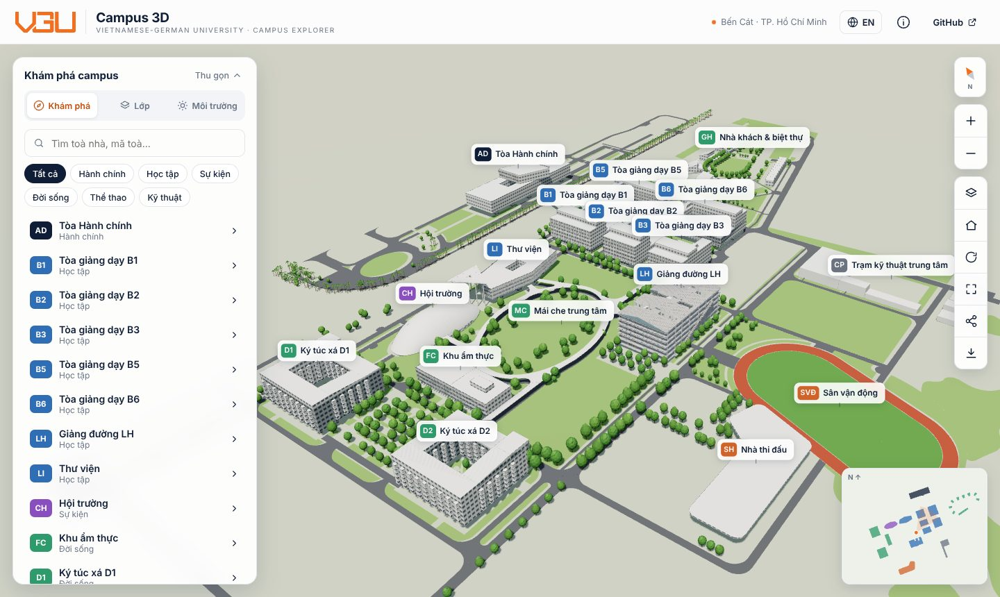
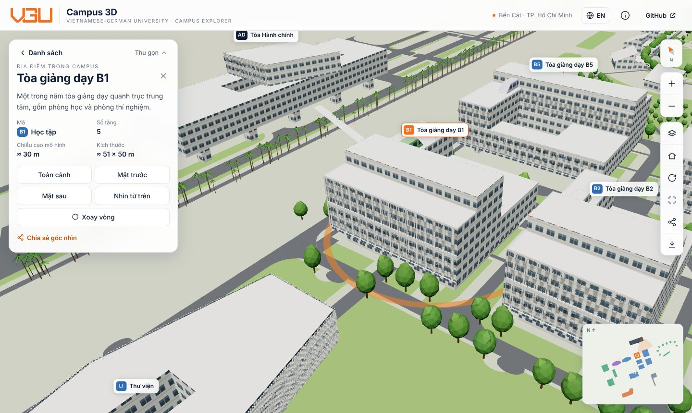
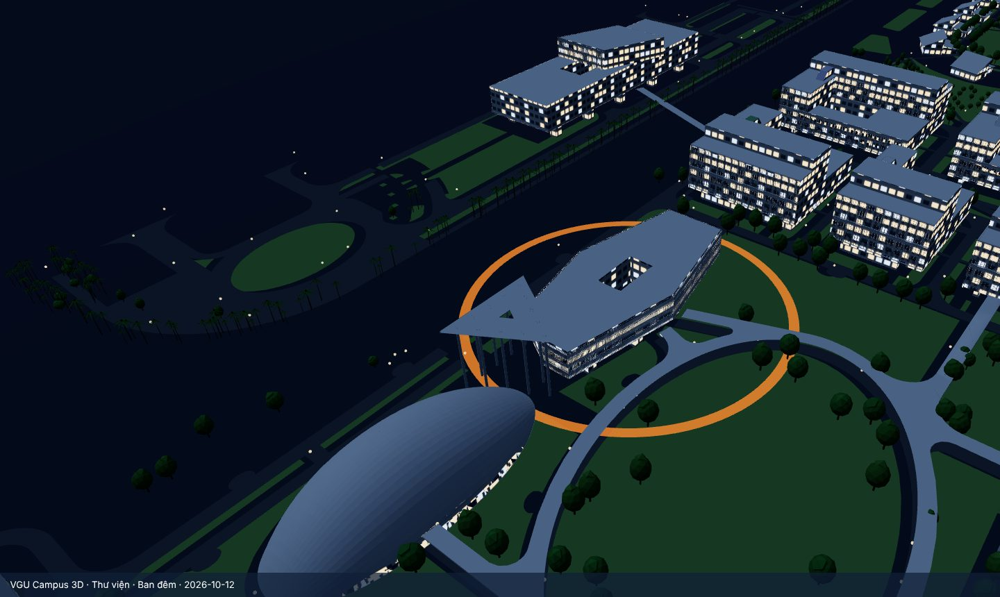
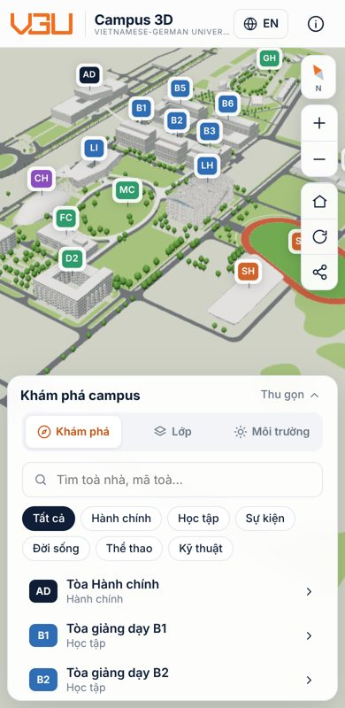

<h1 align="center">VGU · Campus 3D</h1>

<p align="center">
  <b>Tiếng Việt</b> · <a href="#english">English</a>
</p>

<p align="center">
  Bản đồ 3D tương tác khuôn viên <b>Trường Đại học Việt Đức (VGU)</b>, chạy hoàn toàn trên trình duyệt.<br>
  Xây bằng Nuxt 3 + Three.js, không cần máy chủ hay khoá API.
</p>



## Tính năng

- **Khám phá**: tìm kiếm (gõ có dấu hoặc không dấu), lọc theo nhóm (Học tập, Hành chính, Sự kiện, Đời sống, Thể thao, Kỹ thuật), danh sách 18 địa điểm.
- **Chi tiết toà nhà**: mô tả, số tầng, kích thước; các góc camera dựng sẵn *Toàn cảnh · Mặt trước · Mặt sau · Nhìn từ trên · Xoay vòng*.
- **Tham quan tự động**: camera tự bay qua 17 địa điểm, có tạm dừng / tới / lui.
- **Môi trường**: 4 chế độ ánh sáng *Bình minh · Ban ngày · Hoàng hôn · Ban đêm* (ban đêm có cửa sổ sáng đèn và đèn đường).
- **Lớp hiển thị**: bật/tắt toà nhà, cây xanh, thảm cỏ, đường & sân, nhãn tên.
- **Chất lượng tự động**: đo tốc độ khung hình, máy yếu thì tự giảm mật độ cây, tắt bóng đổ, hạ độ phân giải.
- **Chia sẻ góc nhìn** bằng đường link (lưu vị trí camera, toà đang chọn, chế độ sáng) và **tải ảnh PNG**.
- **Bản đồ nhỏ** (bấm để di chuyển), **la bàn**, toàn màn hình, song ngữ **Việt / Anh**, giao diện điện thoại.

| Chi tiết toà nhà | Ban đêm | Điện thoại |
| --- | --- | --- |
|  |  |  |

## Chạy trên máy

Cần Node.js 20 trở lên.

```sh
npm install
npm run dev          # mở http://localhost:3000
```

Xuất web tĩnh: `npm run generate` → thư mục `.output/public`.

## Đưa lên GitHub Pages

1. Tạo repo mới trên GitHub (vd `vgu-campus-3d`), đẩy toàn bộ thư mục này lên nhánh `main`.
2. Vào **Settings → Pages → Build and deployment → Source**: chọn **GitHub Actions**.
3. Workflow `.github/workflows/pages.yml` tự build và đăng. Sau 2–3 phút web có ở
   `https://<tên-tài-khoản>.github.io/<tên-repo>/`.

Đường dẫn gốc và nút “GitHub” trên header được workflow tự đặt theo tên repo, không cần sửa code.

## Cấu trúc

```
pages/index.vue              Trang chính: ghép cảnh 3D + giao diện, tham quan, chia sẻ, PNG
components/                  AppHeader, SidePanel, MapTools, MiniMap, InfoDialog, Icon
composables/useLang.ts       Từ điển Việt / Anh
lib/campus/scene.ts          Cảnh Three.js: tải mô hình, camera, chọn toà, nhãn, chất lượng
lib/campus/presets.ts        Thông số 4 chế độ ánh sáng
lib/campus/trees.ts          Cây xanh vẽ bằng InstancedMesh (2 mẫu cây, ~1.250 cây)
lib/campus/facade.ts         Mặt tiền cửa sổ sinh trong trình duyệt + cửa sổ sáng ban đêm
public/models/*.glb          Mô hình toà nhà, đường, sân vận động, thảm cỏ (nén Draco)
public/data/models.json      Vị trí đặt từng mô hình
public/data/buildings.json   Tên, mô tả, nhóm, số tầng của từng địa điểm  ← sửa nội dung ở đây
public/data/trees.json       Danh sách cây: [x, z, cao, tán, cau/dừa]
public/data/footprints.json  Ranh giới toà nhà cho bản đồ nhỏ
```

**Hệ toạ độ:** mét, `x` = Đông, `y` = lên, `z` = −Bắc, gốc tại toà LH
(kinh độ 106.615027, vĩ độ 11.107046).

### Sửa mô tả / thêm địa điểm

Mở `public/data/buildings.json`, sửa `name`, `description` (có `vi` và `en`), `floors`.
Muốn thêm địa điểm: thêm một mục với `id` trùng `id` của mô hình trong `models.json`,
`center` (x, z) và `size`, `height` để camera biết bay tới đâu.

## Dữ liệu và độ chính xác

- Toà nhà: mô hình SketchUp / IFC của trường, đặt theo toạ độ thật (sai số khoảng 1–4 m).
- Đường, cây xanh, thảm cỏ: từ bản vẽ quy hoạch (CAD), ghép với mạng đường bằng phép xoay + dịch.
- Mặt tiền cửa sổ, hình dáng cây là **hình minh hoạ**, không phải khảo sát thực địa.
- Mô tả toà nhà là mô tả ngắn chung; hãy bổ sung thông tin chính thức của trường.

Các mô hình 3D thuộc về Trường Đại học Việt Đức. Ý tưởng giao diện tham khảo dự án
[gxu-campus-3d](https://github.com/wcqqq1214/gxu-campus-3d) (MIT).

---

<a id="english"></a>

## English

An interactive 3D map of the **Vietnamese-German University (VGU)** campus, running entirely in the browser
(Nuxt 3 + Three.js, no server or API key).

**Features:** search and category filters for 18 places · building details with preset camera views
(overview, front, back, top, orbit) · automatic campus tour · four lighting moods (morning, day, dusk, night with
lit windows and street lamps) · layer toggles · adaptive quality · shareable view links · PNG export ·
mini map, compass, full screen · Vietnamese / English · mobile layout.

**Run locally:** `npm install` then `npm run dev`. Static build: `npm run generate` → `.output/public`.

**Deploy:** push to `main`, then set **Settings → Pages → Source = GitHub Actions**. The workflow sets the
base path and the header's GitHub link from the repository name.

**Edit content:** building names and descriptions live in `public/data/buildings.json`.

**Accuracy:** building models are placed on real coordinates (about 1–4 m error). Roads, trees and lawns come
from the CAD site plan. Window facades and tree shapes are illustrative.
